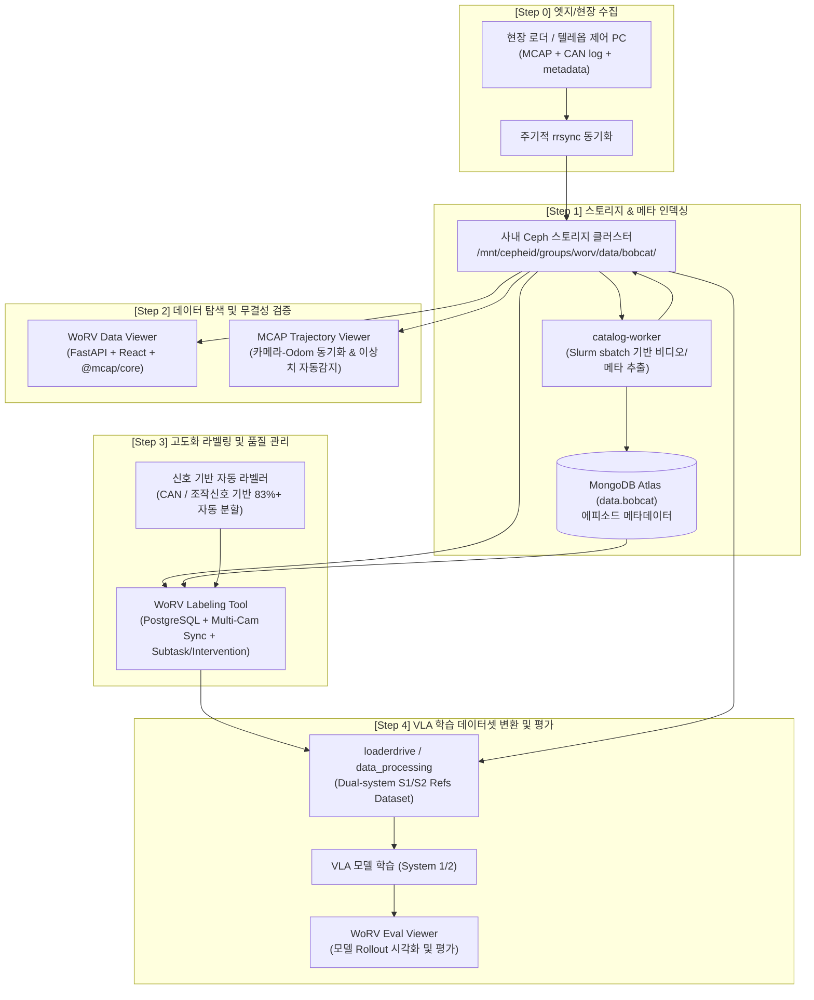

# 두산밥캣(BOBCAT) 데이터 파이프라인 및 자체 개발 툴 분석 보고서

> **문서 출처**: Outline `📁 BOBCAT` 컬렉션 (총 150+ 문서 전수 검토)  
> **조사 일자**: 2026-10-26  
> **목적**: 두산밥캣 로더 자율화/텔레옵 프로젝트에서 구축된 자체 개발 데이터 툴셋 분석 및 타 프로젝트(한화오션 용접 데이터 수집 등) 확장 타당성 검토

---

## 1. 개요 및 데이터 파이프라인 전체 아키텍처

두산밥캣 프로젝트에서는 실차(Compact Track Loader S76 등)의 텔레오퍼레이션(Teleop) 및 자율주행·작업 과정에서 발생하는 멀티모달 센서 데이터(다채널 카메라 영상, 라이다/오도메트리, CAN 유압·조이스틱 제어 신호 등)를 체계적으로 수집, 가공, 라벨링, 검증하기 위해 **전체 수명주기를 아우르는 자체 데이터 인프라 툴체인**을 개발하여 운영 중입니다.

---

## 2. 자체 개발 데이터 툴 상세 명세

### 2.1 WoRV Data Viewer (수집 데이터 브라우징 & 경량 MCAP 분석 툴)

* **개요**: 수집 완료되어 사내 스토리지에 적재된 에피소드/데이터셋을 검색, 탐색, 시각화하고 선별(Curation)하여 다운로드할 수 있는 웹 기반 데이터 포털.
* **접근 URL (Web)**: 
  * 내부 서비스 주소: [https://worv-data-viewer.teleport.svc.internal.maum.ai/](https://worv-data-viewer.teleport.svc.internal.maum.ai/) (Teleport 인증 연동)
* **GitHub 저장소**:
  * 애플리케이션 리포: [`https://github.com/MaumAI-Company/worv-data-viewer`](https://github.com/MaumAI-Company/worv-data-viewer)
  * 인프라/배포 GitOps 리포: [`https://github.com/MaumAI-Company/infra.worv-data-viewer`](https://github.com/MaumAI-Company/infra.worv-data-viewer)
* **기술 스택**:
  * **Backend**: Python FastAPI, SQLite, SQLAlchemy, rosbags
  * **Frontend**: React, TypeScript, Vite, `@mcap/core`
  * **배포**: Kubernetes (ArgoCD 기반 GitOps, `docker-pri.maum.ai:443/worv/worv-data-viewer-{backend,frontend}`)
* **핵심 기능 및 특징**:
  1. **클라이언트 사이드 경량 MCAP 뷰어**: 브라우저 내에서 `@mcap/core`를 이용해 MCAP 내 토픽 요약, 수치 텔레메트리 그래프(IMU, 속도, 제어값)를 직접 파싱하여 렌더링. 서버 부하 없이 실시간 확인 가능.
  2. **다채널 영상 & 드라이브 맵 동기화**: 전방/측방 다채널 비디오와 2D 주행 경로 궤적 동시 표출.
  3. **증분 스캐너(Incremental Scanner)**: 스토리지 변경 시 stat 기반으로 변동된 데이터만 재인덱싱.
  4. **데이터셋 내보내기**: 특정 조건으로 필터링된 에피소드 일괄 ZIP 패키징 및 질의 가능한 SQLite 메타데이터 카탈로그 동시 반출.

---

### 2.2 WoRV Labeling Tool (시나리오/서브태스크/개입 라벨링 툴)

* **개요**: 로봇 및 중장비 VLA(Vision-Language-Action) 모델 학습을 위해 다채널 카메라 영상과 센서 신호를 동기화하여 서브태스크(Skill) 구간 분할, 자연어 Instruction 부여, 원격 주행 중 인간 개입(Intervention) 사유를 정밀 기록하는 웹 플랫폼.
* **접근 URL (Web)**:
  * 프로덕션(Production): [https://label.worvgrip.com/](https://label.worvgrip.com/)
  * 개발 서버(Dev): [https://label-dev.worvgrip.com/](https://label-dev.worvgrip.com/)
  * 현황 대시보드: [https://label.worvgrip.com/dashboard](https://label.worvgrip.com/dashboard)
* **GitHub 저장소**:
  * 리포 주소: [`https://github.com/MaumAI-Company/labeling`](https://github.com/MaumAI-Company/labeling)
* **인프라 및 DB 접속 환경**:
  * **DB 엔진**: PostgreSQL (AWS ap-northeast-2, EC2 인스턴스 `i-09a5d78a2a7ba61d9` 내부 도커)
  * **접속 방식**: 보안을 위해 127.0.0.1에 바인딩되어 있으며 AWS SSM Session Manager 포트포워딩을 통해 접근:
    * Prod: `localhost:16432` -> EC2 `55432` (DB: `labeling`)
    * Dev: `localhost:16433` -> EC2 `55433` (DB: `labeling`)
* **핵심 기능 및 최신 아키텍처 (v1.20+ 및 v2.11+)**:
  1. **다채널 비디오 프레임 동기화 재생**: 최대 5개 카메라 앵글을 동기화하여 재생 및 프레임 단위 스크러빙.
  2. **Subtask(Skill) 구간 분할 및 Instruction 관리**: 전체 녹화본에서 시작/종료 초(`start_s`, `end_s`)를 정의하고 표준화된 `instruction_id` 맵핑.
  3. **인간 개입(Intervention) 상세 기록**: 자율주행/조작 중 모델의 실패나 드리프트를 교정한 구간(`start_s`, `end_s`)과 구체적 사유(`intervention_reason`) 기록.
  4. **작업 품질 평가 및 에이전트 연동 (2026.10 최신 반영)**: 라벨러 수작업 외에 LLM/VLM 기반 에이전트 자동 라벨링 및 품질 점수 자동 채점 워크플로우 통합.
  5. **다중 프로젝트 확장 구조 설계 (2026.10.23 합의안)**:
     * 로그인 직후 프로젝트 선택 화면(Bobcat, Hanwha Ocean 등) 제공 및 역할(Role) 분리.
     * URL prefix 구조(`label.worvgrip.com/bobcat`, `label.worvgrip.com/hanwhaocean`)를 통한 멀티테넌시 지원.

---

### 2.3 MCAP Trajectory & Anomaly Viewer (오도메트리/궤적 이상치 검증 툴)

* **개요**: 수집된 MCAP 내의 카메라 영상과 로봇 위치추정(Odom) 궤적을 3차원/2차원 지도 상에 일치시켜 위치추정 오류 및 센서 신호 끊김을 사전 필터링하는 로컬/웹 뷰어.
* **GitHub 저장소**:
  * 리포 브랜치: [`https://github.com/MaumAI-Company/lidar_localization/tree/tools/mcap-trajectory-viewer`](https://github.com/MaumAI-Company/lidar_localization/tree/tools/mcap-trajectory-viewer)
* **기술 스택**: Python, PyAV (프레임 간 불규칙 도착 타임스탬프를 보존한 무손실 비디오 muxing), Open3D/Matplotlib/Web frontend
* **핵심 기능 및 특징**:
  1. **5대 이상현상(Anomaly) 자동 감지 알고리즘**:
     * `odom_missing`: 사용 가능한 오도메트리 샘플이 1개 이하인 경우
     * `odom_stuck`: x/y 변위가 5cm 미만으로 5초 이상 고착된 경우 (센서 동결 의심)
     * `localization_frozen`: 오도메트리 샘플 간 공백이 1초 이상 발생한 경우
     * `pose_jump`: 연속 샘플 간 속도가 물리적 한계 이상으로 튄 경우 (> 4.0 m/s)
     * `yaw_jump`: 연속 샘플 간 회전율 급변 (> 90 deg/s)
  2. **검토 워크플로우 폴더 트리 자동 분류**:
     * UI 상에서 버튼 클릭 한 번으로 `확인필요` -> `확인완료` 또는 `이상발견` 폴더로 물리적 이동 및 사유 메모(`note.txt`) 자동 생성.
  3. **비디오 캐싱 최적화**: 최초 조회 시 생성된 변환 결과를 `.mcap_viewer_cache`에 보존하여 이후 즉각 로딩.

---

### 2.4 WoRV Eval Viewer (모델 롤아웃 시각화 및 평가 툴)

* **개요**: 학습된 VLA 모델의 시뮬레이션(Isaac Sim / Genesis) 및 실차 환경에서의 롤아웃(Rollout) 추론 결과를 시각화하고 폐루프(Closed-loop) 평가 지표를 분석하는 플랫폼.
* **접근 URL (Web)**:
  * 프로덕션: [https://eval.worvgrip.com/](https://eval.worvgrip.com/) (롤아웃: `/rollouts`)
  * 개발 서버: [https://eval-dev.worvgrip.com/](https://eval-dev.worvgrip.com/)
* **GitHub 저장소**:
  * 리포 주소: [`https://github.com/MaumAI-Company/worv-evalviewer`](https://github.com/MaumAI-Company/worv-evalviewer)
* **핵심 기능**:
  * 모델 추론 영상과 액션 예측 궤적(예측 속도, 조향각, 엔드이펙터 위치)을 실제 주행 궤적과 비교.
  * 성공/실패 여부, 개입 횟수, 작업 완료 시간(Task Execution Time) 등 통계 대시보드 제공.

---

### 2.5 Storage DB & Ingestion Pipeline (`manage-storagedb` & `catalog-worker`)

* **개요**: 현장에서 Ceph 분산 스토리지로 업로드되는 대용량 원본 파일(MCAP, CAN 로그)을 주기적으로 감지하여 비디오 추출, 품질 검증, 메타데이터 인덱싱을 수행하는 백엔드 파이프라인.
* **GitHub 저장소**:
  * 리포 주소: [`https://github.com/MaumAI-Company/manage-storagedb`](https://github.com/MaumAI-Company/manage-storagedb)
* **스토리지 및 데이터베이스 위치**:
  * **원천 스토리지**: `/mnt/cepheid/groups/worv/data/bobcat/recordings/<YYYYMMDD>/<ULID>/`
    * 저장 구조: `<ULID>.json` (녹화 메타), `<ULID>.mcap` (센서/토픽), `can0.log`, `can1.log`
  * **메타데이터 DB**: MongoDB Atlas 클러스터 (`data` DB 내 `bobcat` 컬렉션)
    * 연결 URI: `mongodb+srv://<계정명>:<비밀번호>@worv.wtfib9v.mongodb.net/`
* **주요 워커 컴포넌트**:
  * **`catalog-worker`**: Slurm `sbatch` 기반 분산 워커. 업로드된 MCAP에서 카메라별 개별 비디오(`rgb_*.mp4`)를 고속 추출하고, 프레임 누락 검증 파일(`cam_gaps.json`)을 생성하여 MongoDB Atlas에 상태를 자동 갱신.
  * **Soft-deletion 계약**: 데이터 삭제 시 물리적 삭제 대신 `sync.deleted_at` 타임스탬프를 부여하여 정합성 보장.

---

### 2.6 신호 기반 자동 라벨러 (Signal-based Auto-Labeler)

* **개요**: 수작업 영상 시청 없이, 원격 제어 토픽(`/cmd_motion`)과 차량 CAN 버스 신호(유압, 궤도 속도, 버킷 IMU)의 수치 조건을 규칙화하여 스펙에 정의된 동작(Verb) 세그먼트를 83% 이상 자동 추출하는 알고리즘.
* **핵심 특징**:
  1. **텔레옵-차량 클록 비동기 정렬**: 차량 시계와 원격 조작자 화면 간 지연(Latency) 토픽을 매칭하여 시계 드리프트 없이 1-frame 단위로 정확하게 동기화.
  2. **접지 및 자세 자동 판정**: IMU와 유압 압력 임계값 기반으로 지면 접촉 순간, 부하 발생 구간 자동 태깅.

---

### 2.7 VLA 데이터셋 전처리 파이프라인 (`loaderdrive/data_processing`)

* **개요**: 수집 및 라벨링이 완료된 에피소드를 VLA 모델(Dual-system)의 입력 형태에 맞게 최종 변환하는 배치 처리 스크립트.
* **GitHub 저장소**:
  * 리포 주소: [`https://github.com/MaumAI-Company/loaderdrive`](https://github.com/MaumAI-Company/loaderdrive)
  * 경로: `loaderdrive/data_processing/` (`config.dualsys.yaml`, `dualsys_slurm.sbatch`)
* **핵심 처리 내용**:
  * **System 1 (저지연 연속 제어 모델)**: 고용량 영상을 전부 압축 풀지 않고 원본 MP4의 타임스탬프와 프레임 인덱스(`uri`, `idx`, `pts_ns`)만을 가리키는 **Refs Dataset** 생성 (15Hz/30Hz 정렬).
  * **System 2 (고수준 언어 지시 모델)**: 자연어 지시문과 주요 씬 이미지를 쌍으로 묶어 HuggingFace Dataset 포맷으로 변환.

---

## 3. 자체 개발 툴 요약 매트릭스

| 툴 / 시스템명 | 주요 역할 | 접근 주소 / 엔드포인트 | 관련 GitHub 리포지토리 |
| :--- | :--- | :--- | :--- |
| **WoRV Data Viewer** | 수집 에피소드 브라우징, 클라이언트 MCAP 파싱, 데이터 선별 및 SQLite 반출 | [data-viewer](https://worv-data-viewer.teleport.svc.internal.maum.ai/) | [worv-data-viewer](https://github.com/MaumAI-Company/worv-data-viewer) [infra.worv-data-viewer](https://github.com/MaumAI-Company/infra.worv-data-viewer) |
| **WoRV Labeling Tool** | 다채널 비디오 동기화, 서브태스크 분할, 언어 지시문 및 개입(Intervention) 라벨링 | [label.worvgrip.com](https://label.worvgrip.com/) [label-dev](https://label-dev.worvgrip.com/) | [labeling](https://github.com/MaumAI-Company/labeling) |
| **MCAP Trajectory Viewer** | 카메라-궤적 동기화, 5대 이상치 자동 감지, 확인필요/완료/이상 분류 | 로컬 웹 뷰어 (포트 8080) | [lidar_localization (tools)](https://github.com/MaumAI-Company/lidar_localization/tree/tools/mcap-trajectory-viewer) |
| **WoRV Eval Viewer** | 모델 추론 롤아웃 시각화, 폐루프 평가 지표 추적 및 분석 | [eval.worvgrip.com](https://eval.worvgrip.com/) | [worv-evalviewer](https://github.com/MaumAI-Company/worv-evalviewer) |
| **Storage DB & Catalog** | 현장 업로드 자동 감지, Slurm 분산 비디오 추출, 프레임 누락 검증, 메타 인덱싱 | MongoDB Atlas (`data.bobcat`) Ceph `/mnt/cepheid/...` | [manage-storagedb](https://github.com/MaumAI-Company/manage-storagedb) |
| **Auto-Labeler** | CAN/제어 신호 기반 서브태스크 구간 자동 분할 알고리즘 | 배치 스크립트 | 사내 알고리즘 모듈 |
| **VLA Dataset ETL** | MCAP + Label을 System 1 Refs Dataset / System 2 HF Dataset으로 변환 | Slurm `dualsys_slurm.sbatch` | [loaderdrive](https://github.com/MaumAI-Company/loaderdrive) |
