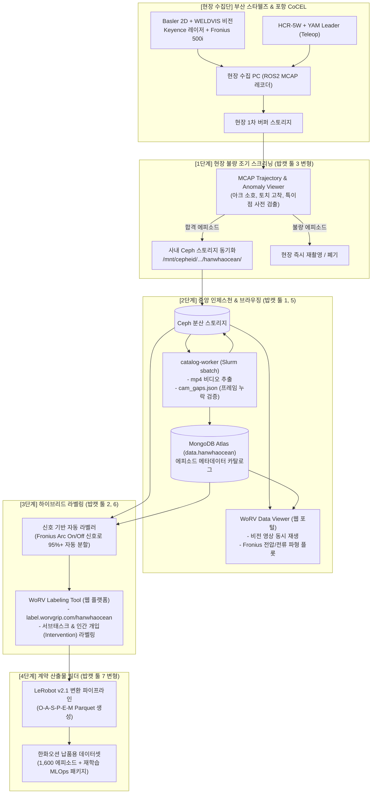
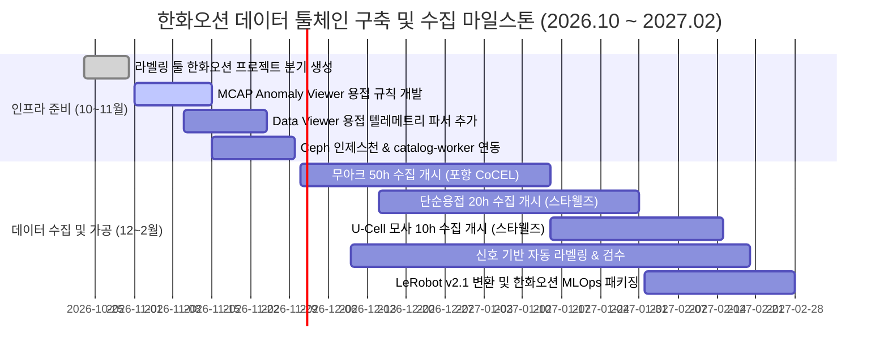

# 한화오션 곡블록 자율용접 데이터 수집을 위한 밥캣(BOBCAT) 데이터 툴 재사용 계획서

> **기준 근거**: 
> 1. 한화오션 기술용역 사양서 (곡블록 용접로봇 시스템 개발 r2_260827)
> 2. 마음AI 제안서 최종본 (2026.07.29) & 계약서 최종본 (2026.08.31)
> 3. 한화오션 WBS 업무분장(2026.08.20) 및 성공지표 협의록 (`78d8a092-59fd-43f0-b9b0-b3dfd630ebaa`)
> 4. 파트너사 계약서 (스타웰즈 2026.09.11, CoCEL 포항공대)
> 
> *(※ 주의: Outline 내 260905 데이터 수집 흐름도 및 260906 데이터 수집 NAS 문서는 초기 AI 대화 초안에 불과하므로 본 계획은 전면 공식 계약 및 제안 사양서에 기반하여 수립함)*

---

## 1. 한화오션 계약·제안서 기반 데이터 수집 핵심 요구사항 분석

한화오션과의 최종 계약 및 기술용역 사양서에서 정의된 **WP#2 (데이터 수집 파이프라인 및 데이터셋 구축)** 및 **WP#3 (VLA 모델 및 MLOps)**의 공식 요구 조건은 다음과 같습니다.

### 1.1 데이터 수집 규모 및 구성 (공식 합의안)
초기 RFP의 비현실적인 300시간/5만 에피소드 요구에 대해, 마음AI가 제안하고 한화오션이 최종 승인한 수집 계획:
* **총 수집 규모**: **80시간**, **1,600개 에피소드 (Episode)**
* **단계별 구성**:
  1. **무아크(Non-arc / Dry-run) 데이터 (50시간, ~1,000 에피소드)**: 포항공대 CoCEL 연구실 및 스타웰즈에서 토치 미점화 상태로 갭 탐색, 토치 접근, 위빙 경로 추종 수행.
  2. **단순 용접 데이터 (20시간, ~400 에피소드)**: 부산 스타웰즈 용접 작업장에서 2F(수평 필렛), 3F(수직 필렛) 평판 시편(Gap 0, 3, 5mm) 대상 실제 아크 용접.
  3. **U-Cell 모사 용접 데이터 (10시간, ~200 에피소드)**: 협소 공간 U-Cell 구조물(평판 및 곡블록 모사체) 내부에서 실제 아크 용접 및 간섭 회피 교시.
* **추가 합성 데이터**: 마음AI 시뮬레이션팀(Isaac Sim)에서 가상 HCR-5W 및 10종 시편 기반 합성 에피소드 병행 생성.

### 1.2 수집 하드웨어, 센서 및 공정 신호 스펙
* **협동로봇 및 텔레옵 제어기 (WP#1)**:
  * 팔로워암: 한화로보틱스 **HCR-5W** (용접 특화 협동로봇, 관절각/속도/토크 및 TCP 6-DoF, 위빙 0.5~2Hz / 진폭 3~10mm)
  * 리더암: 마음AI 자산 **YAM Leader** 2대(CoCEL `YAM-26090144`, 스타웰즈 `YAM-26090262` 선행 배치 완료) → 11월 말 한화로보틱스 정식 리더암 통합.
* **센서 패키지**:
  * 2D 외부 감시 카메라: **Basler Ace acA1920-48gc** (GigE, 전경 뷰)
  * 용접 비전 카메라: **WELDVIS MC-315B-B25AWD** (HDR 비드/아크 풀 모니터링)
  * 레이저 프로파일러: **Keyence LJ-X8200** (용접선 갭/단차 계측)
  * 3D 구조광 카메라: **Mech-Mind Mech-Eye PRO M-GL** (U-Cell 3차원 형상 스캔)
* **용접기 공정 신호**:
  * **Fronius TPS 500i** 용접기 (펜던트형 통신보드 연동, Ethernet/IP 기반)
  * 실시간 모니터링: **용접 전류(A), 아크 전압(V), 와이어 송급속도(m/min), 아크 활성화 비트(Arc On/Off), 가스 유량** (10~100Hz 수집).

### 1.3 데이터 표준 포맷 및 산출물 계약 조건
1. **범용 로봇 데이터셋 포맷 호환**:
   * 특정 벤더에 종속되지 않고 타 개발사 및 오픈 로보틱스 커뮤니티가 활용할 수 있는 **LeRobot v2.1** 또는 **Open X-Embodiment** 표준 포맷(Parquet 기반 O-A-S-P-E-M 구조)으로 납품.
2. **동기화 및 무결성 기준**:
   * 비디오(Basler, WELDVIS)와 로봇 제어 명령 간 동기화 오차 최소화.
   * 센서 프레임 드롭(Frame Drop) 검증 및 시간 역전 현상 배제.
3. **한화오션 자체 재학습 및 MLOps 내재화 보장 (핵심 계약 사항)**:
   * 한화오션이 과제 종료 후 현장에서 데이터를 추가 수집하여 모델을 직접 파인튜닝(Fine-tuning)할 수 있도록, **데이터 수집 플랫폼, 전처리 스크립트, 재현 가능한 학습 파이프라인 및 운영 매뉴얼**을 라이브러리 형태로 제공해야 함.

---

## 2. 밥캣 데이터 툴체인과 한화오션 요구사항 간 매핑 구조

두산밥캣 프로젝트에서 개발된 7대 자체 툴체인은 **수집(MCAP) → 저장/인덱싱(Ceph/Mongo) → 검증(Data Viewer) → 선별(Anomaly Viewer) → 라벨링(Labeling Tool) → VLA 데이터셋 변환(ETL)**의 전주기를 이미 포괄하고 있습니다.

---

## 3. 세부 툴별 재사용 및 엔지니어링 구현 계획

### 3.1 [툴 1] WoRV Data Viewer → 용접 데이터 웹 포털 및 한화오션 납품 뷰어
* **소스 리포**: [`MaumAI-Company/worv-data-viewer`](https://github.com/MaumAI-Company/worv-data-viewer)
* **재사용 방법**:
  1. **클라이언트 사이드 `@mcap/core` 파서 활용**:
     * 용접 동영상(Basler, WELDVIS)과 함께, MCAP 내 ROS2 토픽으로 저장된 Fronius 500i의 **용접 전류(`/welder/current`), 아크 전압(`/welder/voltage`), 와이어 송급속도(`/welder/wire_feed_speed`)** 토픽을 수치 그래프로 동기화 렌더링.
  2. **메타데이터 속성 트리 커스텀**:
     * 데이터셋 레코드 속성을 한화오션 작업 조건에 맞게 구성:
       * `specimen_type`: `2F_Plate`, `3F_Plate`, `Flat_UCell`, `Curved_UCell`
       * `gap_size`: `0mm`, `3mm`, `5mm`
       * `welding_pass`: `Pass_1`, `Pass_2`
       * `operator_id`: 숙련 용접사 식별자
  3. **계약 납품 연계 (SQLite 카탈로그 기능)**:
     * `worv-data-viewer`는 선택한 에피소드들을 ZIP으로 묶고 메타데이터가 담긴 **SQLite 카탈로그 파일**을 함께 생성하는 기능을 이미 갖추고 있음.
     * 한화오션에 데이터셋을 인계할 때, 한화오션 연구진이 자체적으로 데이터를 검색·검토할 수 있는 오프라인/온프레미스 뷰어로 패키징하여 납품 산출물로 제공.

---

### 3.2 [툴 2] WoRV Labeling Tool → 용접 공정 & 숙련공 개입(Intervention) 라벨링
* **소스 리포**: [`MaumAI-Company/labeling`](https://github.com/MaumAI-Company/labeling)
* **배포 및 도메인 분기**:
  * 2026년 10월 23일 확정된 멀티프로젝트 설계에 따라 **`https://label.worvgrip.com/hanwhaocean`** URL Prefix 분기 활성화.
  * 부산(스타웰즈), 포항(CoCEL), 판교(마음AI) 작업자별 권한(Role) 분리 및 단일 포털 운영.
* **용접 공정 라벨링 스키마 구현**:
  1. **6단계 표준 서브태스크(Skill) 정의**:
     * `APPROACH_SEAM`: 비드 시작 지점으로 토치 위치 정렬
     * `SEAM_SCAN`: 레이저 프로파일러/비전을 이용한 갭 및 중심선 사전 계측
     * `ARC_IGNITION`: 아크 발생 및 비드 풀(Puddle) 형성
     * `WEAVING_WELD`: 본 용접 수행 (위빙 진폭 3~10mm, 주파수 0.5~2Hz)
     * `CRATER_FILL`: 종점 크레이터 방지 전류 감쇄 제어
     * `RETRACT_INSPECT`: 토치 안전 후퇴 및 비드 외관 검사
  2. **숙련 용접사 텔레옵 개입(Intervention) 라벨링 (계약서 명시 품질 분석 대응)**:
     * 텔레옵 중 숙련 용접사가 미세 보정을 수행한 구간(`start_s`, `end_s`)과 구체적 사유(`intervention_reason`) 기록:
       * `SPATTER_SURGE`: 스패터 급증 시 아크 길이 및 전압 미세 조정
       * `GAP_EXPANSION`: 국부적 갭 확장 구간에서 위빙 폭 확대 및 진행속도 저하
       * `UNDERCUT_AVOIDANCE`: 모재 파임 방지를 위한 토치 각도(작업각/전진각) 보정
  3. **품질 점수(Quality Scoring)**:
     * 용접 완료 후 스타웰즈 시니어 용접사가 비드 외관, 비드 높이, 각장 균일도를 평가하여 1~5점 점수 부여.

---

### 3.3 [툴 3] MCAP Trajectory & Anomaly Viewer → 현장 1차 불량 필터링 뷰어
* **소스 리포**: [`MaumAI-Company/lidar_localization (branch: tools/mcap-trajectory-viewer)`](https://github.com/MaumAI-Company/lidar_localization/tree/tools/mcap-trajectory-viewer)
* **목적**: 부산/포항 현장에서 수집된 80시간 분량의 에피소드 중 **불량 데이터를 사내 서버로 전송하기 전에 현장 PC에서 즉시 적색 경고로 검출**하여 조기 격리.
* **용접 특화 5대 이상치 트리거(Custom Watchdog) 개발**:
  1. `torch_stuck` (토치 고착): 아크 온($I > 15\text{A}$) 상태에서 로봇 TCP 이동 속도가 0.5초 이상 0에 수렴 (**모재 관통/Burn-through 위험** 사전 감지).
  2. `arc_extinction` (불시 소호): 용접 구간 중 아크 전원/전류 신호가 예기치 않게 0으로 떨어져 끊긴 경우.
  3. `wire_stickout_error` (돌출길이 이탈): 모재 대비 TCP 거리가 스펙 기준(17 mm) 대비 허용공차(±3mm)를 벗어난 경우.
  4. `singularity_jump` (로봇 특이점): HCR-5W 6개 관절 중 급격한 각속도 도약이 발생한 경우.
  5. `cam_sync_drift` (비전 동기화 드리프트): Basler 영상과 WELDVIS 영상 간 프레임 타임스탬프 차이가 5ms를 초과한 경우.
* **현장 운영 워크플로우**:
  * 현장 수집 PC 폴더 구조: `수집원본/` → 툴에서 확인 후 `확인완료/` (자동 Ceph 동기화) 또는 `이상발견/` (폐기 및 사유 `note.txt` 저장).

---

### 3.4 [툴 4] Storage DB & Ingestion Pipeline (`catalog-worker`)
* **소스 리포**: [`MaumAI-Company/manage-storagedb`](https://github.com/MaumAI-Company/manage-storagedb)
* **재사용 구성**:
  1. **현장 NAS ↔ 사내 Ceph 자동 동기화**:
     * 부산 스타웰즈 및 포항 CoCEL 현장 PC에서 검수 완료된 에피소드를 사내 Ceph 스토리지(`/mnt/cepheid/groups/worv/data/hanwhaocean/recordings/`)로 `rrsync` 전송.
  2. **Slurm 분산 배치 검증 워커 (`catalog-worker`)**:
     * 업로드된 MCAP에서 카메라별 mp4 추출.
     * **`cam_gaps.json` 자동 생성**: 계약서상 필수 조건인 **카메라 프레임 누락(Drop) 여부 및 평균 동기화 지연시간(5ms 이내)**을 자동 산출하여 검증 리포트 발행.
  3. **메타데이터 카탈로그 구축**:
     * MongoDB Atlas에 `hanwhaocean` 컬렉션을 생성하고 1,600개 에피소드의 메타 정보(시편, 갭, 용접사, 프레임 누락율, 용접 전력 파라미터)를 실시간 인덱싱.

---

### 3.5 [툴 5] 신호 기반 자동 라벨러 → 용접 전력 신호 기반 95%+ 자동 분할기
* **원천 알고리즘**: 밥캣에서 시험 적용된 `신호 기반 자동 라벨링` (리비전 67)
* **용접 도메인의 압도적 장점**:
  * 밥캣 토공 작업과 달리, 용접 공정은 **Fronius의 디지털 상태 신호**가 매우 뚜렷함:
    * `APPROACH`: 로봇 이동 중 & Fronius `Arc_Active == False`
    * `ARC_IGNITION`: `Arc_Active == True` 및 전류 급상승 구간
    * `WEAVING_WELD`: HCR-5W 관절 궤적에 0.5~2Hz 주기적 진동 검출 & $I > 15\text{A}$ 유지 구간
    * `CRATER_FILL`: 전류가 설정된 슬로프(Down-slope)로 감소하는 구간
    * `RETRACT`: `Arc_Active == False` 후 홈 포지션 복귀 구간
* **기대 효과**:
  * 수작업 비디오 타임스탬프 태깅 없이, **신호 분석 알고리즘만으로 1,600개 에피소드의 95% 이상을 0.01초 오차 이내로 자동 분할**.
  * 라벨러는 자동 생성된 경계를 검토하고 숙련 용접사의 개입(Intervention) 사유만 추가 입력하므로, **라벨링 작업 공수를 80% 이상 절감**.

---

### 3.6 [툴 6] VLA 전처리 파이프라인 → LeRobot v2.1 표준 변환기
* **소스 리포**: [`MaumAI-Company/loaderdrive`](https://github.com/MaumAI-Company/loaderdrive) (`loaderdrive/data_processing/`)
* **변환 아키텍처**:
  * 밥캣의 System 1 (연속 액션 Refs) + System 2 (언어 지시문) 생성 로직을 한화오션 계약 산출물 규격인 **LeRobot v2.1 (Parquet 포맷)** 구조로 매핑:

| LeRobot v2.1 필드 | 데이터 소스 (Hanwha Ocean) | 사양 및 설명 |
| :--- | :--- | :--- |
| **Observation (O)** | `rgb_basler.mp4`, `rgb_weldvis.mp4` Keyence 포인트클라우드 | 전경 2D 영상 (30Hz) + 용접 풀 HDR 영상 (30Hz) + 레이저 갭 단면 프로파일 |
| **Action (A)** | HCR-5W 제어 명령 | TCP 위치/자세 델타 ($\Delta x, \Delta y, \Delta z, \Delta \text{roll}, \Delta \text{pitch}, \Delta \text{yaw}$), 위빙 목표값, Fronius 전압/전류 프리셋 지령 |
| **State (S)** | HCR-5W 피드백 & Fronius 실측 | 로봇 6축 관절 각도/토크 (100Hz) + 실측 용접 전류/전압/송급속도 (50~100Hz) |
| **Parameter (P)** | 정적 메타데이터 | 모재 두께, 루트 갭(0/3/5mm), 그루브 형상, 토치 꺾임각(33.9°), 와이어 돌출길이(17mm) |
| **Evaluation (E)** | 라벨링 툴 결과 | 서브태스크 ID, 숙련공 개입 사유, 최종 비드 품질 점수 (1~5점) |
| **Meta (M)** | 녹화 메타 (`<ULID>.json`) | 에피소드 ID, 시편 ID, 용접사 식별자, 수집 일시, 환경 온·습도 |

---

## 4. 재사용 추진 일정 및 마일스톤 연계 (WBS)

한화오션 KOM2 공식 스케줄 상의 WP#2 일정에 맞춘 툴체인 이식 일정:

---

## 5. 기대 효과 및 결론

1. **개발 리드타임 3개월 단축**:
   * 신규 뷰어, 라벨링 시스템, 스토리지 파이프라인을 밑바닥부터 개발하지 않고, 이미 수천 개 에피소드로 검증된 밥캣 툴셋을 즉시 재사용하여 **12월 초 데이터 수집 개시 일정을 차질 없이 완벽 지원**.
2. **라벨링 비용 80% 절감**:
   * Fronius의 디지털 신호를 활용한 '신호 기반 자동 라벨러'를 통해 1,600개 에피소드의 95% 구간을 자동 분할함으로써 막대한 인건비와 소요 시간 절감.
3. **계약 산출물 완벽 부합 및 고객 신뢰도 극대화**:
   * 한화오션이 강력하게 요구한 **"범용 LeRobot 데이터셋 포맷 호환"** 및 **"과제 종료 후 한화오션의 데이터셋 재활용/파인튜닝 내재화"** 요건을 `worv-data-viewer`의 SQLite 카탈로그 반출 기능과 `loaderdrive` ETL 파이프라인으로 100% 충족.
